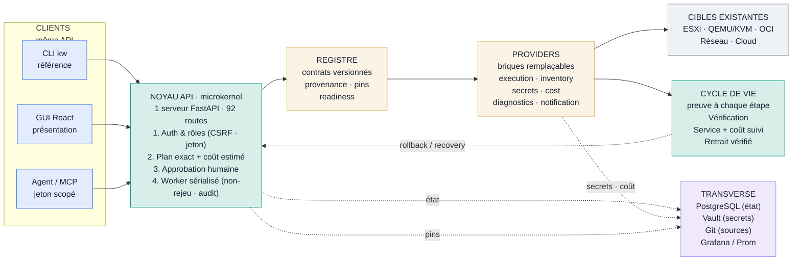

# KuberWeaver — Architecture technique (interactive)

Diagramme d'architecture complet, pensé pour que toute l'équipe comprenne rapidement comment ça se passe.
Le bloc Mermaid ci-dessous est **interactif** : cliquable, zoomable, éditable. Le rendu print une page A4 paysage
est dans `KuberWeaver_Architecture_Technique.pdf`.

## Diagramme

## Ouvrir / éditer le diagramme interactif

- **VS Code** : extension « Markdown Preview Mermaid Support », ouvrir ce fichier puis aperçu Markdown.
- **GitHub** : le bloc `mermaid` se rend tout seul en poussant ce fichier ; les nœuds cliquables ouvrent les docs.
- **mermaid.live** : coller le contenu de `architecture.mmd` pour zoomer, déplacer, cliquer, exporter.
- **CLI** : `mmdc -i architecture.mmd -o architecture.svg` (paquet `@mermaid-js/mermaid-cli`).

## Légende & outils branchés

- Clients (bleu) : CLI kw (référence), GUI React (présentation), Agent/MCP (jeton scopé). Même API, aucune logique métier.
- Noyau / cycle de vie (vert) : microkernel FastAPI (92 routes) ; vérification, service suivi, retrait.
- Providers (ambre) : execution = OpenTofu / Ansible ; cost = OpenCost / Infracost ; secrets = Vault (références) ;
  inventory, diagnostics IA read-only, notification. Briques remplaçables à contrats fermés.
- Cibles (gris) : ESXi, QEMU/KVM, OCI, Réseau (GNS3 / Cisco / pfSense), Cloud. On orchestre, on ne remplace pas.
- Transverse (violet) : PostgreSQL (état prod), Vault (secrets), Git (sources épinglées), Grafana/Prometheus (externes).

## Règles immuables (quel que soit le client ou le provider)

1. Une seule porte : l'API. CLI, GUI et agent appliquent les mêmes rôles et pins.
2. Approbation humaine avant toute exécution ; rien ne se déploie sans accord.
3. Pins de source et de plan exact ; un changement invalide l'approbation.
4. Vérification indépendante, puis retrait vérifié (ressources absentes, preuve).
5. Worker sérialisé, non-rejeu au redémarrage ; aucun secret dans les plans / logs.

## Comment ça se passe (déroulé)

1. **Demande** — choix d'une offre revue, paramètres.
2. **Plan + coût** — plan exact épinglé, coût estimé.
3. **Approbation** — un admin valide le plan.
4. **Exécution** — le provider déploie sur la cible.
5. **Vérification** — preuve indépendante que ça marche.
6. **Service + coût** — état et dépense suivis.
7. **Retrait** — ressources supprimées, preuve.

---
KuberWeaver · EFREI Paris · novembre 2026. Rendu print : `KuberWeaver_Architecture_Technique.pdf` (A4 paysage, 1 page).
